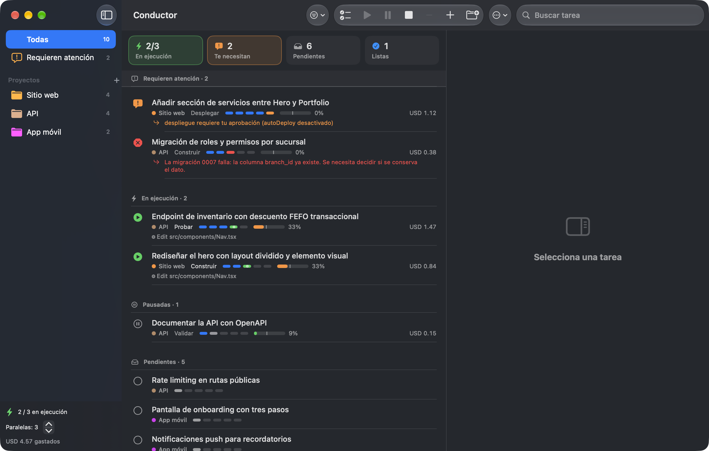

# ⚡ Conductor

App de Mac (SwiftUI) para orquestar sesiones de Claude Code sobre todos tus proyectos: lanzas tareas de varios
repos en paralelo y cada una recorre sola planear → validar → construir → probar → desplegar.

    ./app/build-app.sh          # compila y empaqueta dist/Conductor.app
    open dist/Conductor.app

Requisitos: macOS 14+, Swift (Command Line Tools, no hace falta Xcode), Node 20+ y `claude` en el PATH.

## Arquitectura
- `app/`  Interfaz nativa SwiftUI. Lanza el motor como proceso hijo y habla con él por stdio (JSON de una línea).
- `src/`  Motor Node sin dependencias (`server.js` es el punto de entrada). Estado y configuración en `~/.conductor/`.
- `bin/conductor.js`  CLI auxiliar: `import | clean | add <proyecto> <título> | status`.

## Cómo funciona
- **Tareas**: se importan de `TASKS.md` / `TODO.md` / `.planning/ROADMAP.md` (`- [ ]`) y de `orchestrator/tasks.json`, o se crean con ⌘N.
- **Pipeline por tarea** (cada fase = sesión propia de `claude -p`): Planear → Validar → Construir → Probar → Desplegar.
  Si Probar falla vuelve a Construir (hasta `maxFixLoops`).
- **Contexto**: se lee el `usage` de cada mensaje; al llegar al límite (40% por defecto) se detiene la sesión, se escribe
  `HANDOFF.md` y continúa en una sesión nueva (`~/.conductor/tasks/<id>/`).
- **Aislamiento**: un `git worktree` + rama `conductor/<id>` por tarea → varias en paralelo sin pisarse.
  Proyectos sin git: una tarea a la vez.
- **Admin** (`src/admin.js`): agente de sólo lectura. Ante un bloqueo/fallo decide solo (hasta `maxAdminInterventions`) y
  reintenta con una indicación; escala a ti decisiones de producto, credenciales, dinero o acciones irreversibles.
  Con `autoDeploy` revisa el diff antes de aprobar. Nunca salta las reglas duras (`deployCmd`, `autoDeploy`).
- **Deploy**: sólo si el proyecto tiene `deployCmd`; con `autoDeploy` desactivado pide tu aprobación.

## En la app
- Selecciona varias tareas (⌘/⇧-clic) y pulsa ▶ (⌘↩) para lanzarlas en paralelo; ☑ selecciona todas las visibles.
- Panel de detalle: fases, contexto, costo, actividad en vivo, y aprobar / dar indicación / reintentar.
- «Abrir en Terminal» abre esa sesión con `claude --resume` para intervenir a mano.
- Barra de menús: tareas corriendo y las que necesitan atención (aprobar deploys desde ahí).
- Notificaciones y badge en el Dock cuando algo requiere tu atención, falla o termina.
- Cerrar la ventana no detiene nada; salir pausa las tareas y se reanudan donde quedaron.
- Evita que el Mac se duerma mientras hay tareas corriendo.
- Panel izquierdo con tu **uso del plan**: barra de la sesión de 5 h, de la semana y de lo que te queda, con cuenta
  regresiva al reinicio. Los datos vienen de Anthropic (porcentajes, no un conteo de tokens). Si se alcanza el límite,
  Conductor deja de lanzar tareas nuevas y reanuda solo cuando la ventana se reinicia.
- Ajustes (⌘,): paralelismo, límite de contexto, admin, proyectos (ruta, pruebas, deploy) y modelos por fase.

## Licencia
MIT — ver `LICENSE`.
